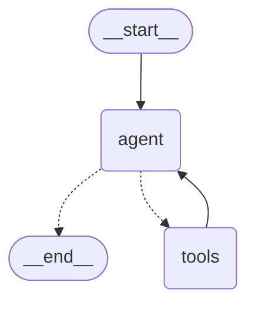

# Advisor

`POST /advisor/chat` answers questions in natural language with Sobreplano's data only (SPEC 08):
search and compare projects, explain how much they have risen, simulate a mortgage, compute what a
household can afford and the monthly down payment while the project is built.

## Graph

Built by hand with `StateGraph` (`src/sobreplano/infrastructure/advisor/graph.py`), so every step
of the loop is visible and guardrail nodes can be added later (SPEC 10). Rendered with
`get_graph().draw_mermaid()`:



- `agent` calls the model with the system prompt and the messages of the last 8 questions, cut at a
  user message so no tool call is left without its result.
- `tools` is a `ToolNode`; bad arguments (`DomainValidationError`, invalid tool input) go back to
  the model as a tool error, any other error reaches the route as a 503.
- Memory per conversation: `PostgresSaver` keyed by `thread_id`, on one psycopg connection per
  request. Its tables are created by migration `0007`; `setup()` is never called.
- LangGraph and LangChain live only in `infrastructure/advisor/`. The use case
  (`application/ask_advisor.py`) only knows the `AdvisorAgent` port; import-linter enforces it.

## Tools

Pydantic input and output (`tool_schemas.py`), compact JSON without nulls.

| Tool | What it returns |
| --- | --- |
| `search_projects` | Projects matching the filters (`name` ignores case and accents, and is how the model gets a slug), with the unit types that match: latest price and date, price per m², change since the first price, `source_url` |
| `get_project` | One project; per unit type first, min and max price, number of observations and the last 20 price changes |
| `compare_projects` | 2–3 projects, one row per unit type, and the unit type with the lowest price per m² |
| `list_developers` | Developers with their slug and project count |
| `simulate_mortgage` | Fixed payment, total paid, interest and minimum income (payment ≤ 40 % of income) |
| `max_affordable_price` | Highest price by income and by savings, and which one limits |
| `down_payment_plan` | Monthly down payment until delivery and what is left for the loan |

The maths is in `domain/finance.py` (pure, `Decimal`, tested); the model never does arithmetic.
The rate has no default: the advisor asks for it.

## Limits

| Limit | Value | Where |
| --- | --- | --- |
| Message length | 1,000 characters | route (`422`) |
| Tool rounds per message | 5 (`recursion_limit` 11) | graph (`503`, spend recorded) |
| Output tokens per model call | 1,024 | `chat_models.py` |
| Messages per conversation | 20 (`ADVISOR_MAX_TURNS`) | use case (`409`) |
| Daily budget | 0.20 USD (`ADVISOR_DAILY_BUDGET_USD`), day in America/Bogota | use case (`503`, model not called) |

Every model call is logged in `llm_usage` (model, tokens, cost) with its `thread_id`, also when the
turn ends in too many tool rounds. Calls of a model without a price in
`infrastructure/llm/providers.py` have a NULL cost and do not count toward the budget.

## Configuration

| Variable | Default |
| --- | --- |
| `ADVISOR_MODEL` | `openai:gpt-6-luna` (same provider table as the extractor) |
| `ADVISOR_REASONING_EFFORT` | `low` |
| `ADVISOR_DAILY_BUDGET_USD` | `0.20` |
| `ADVISOR_MAX_TURNS` | `20` |

Without the provider's API key the API starts and the advisor answers `503 advisor unavailable`.

## Run

```bash
uv run --env-file .env uvicorn sobreplano.interface.api.main:app
curl -s -X POST localhost:8000/advisor/chat -H 'content-type: application/json' \
  -d '{"message": "Busco 3 alcobas en Sabaneta por menos de 450 millones"}'
# continue with the thread_id of the answer
curl -s -X POST localhost:8000/advisor/chat -H 'content-type: application/json' \
  -d '{"message": "¿Y cuánto ha subido el primero?", "thread_id": "<thread_id>"}'

uv run --env-file .env python -m sobreplano.interface.cli.advise            # terminal chat
uv run --env-file .env python -m sobreplano.interface.cli.advise --thread <thread_id>
RUN_LLM_TESTS=1 uv run --env-file .env pytest tests/llm/test_advisor_live.py -s   # paid
```

## Retention and privacy

Conversations are anonymous. The prompt never asks for personal data and does not repeat it.
`advisor_threads` keeps only the message count and last activity; the messages live in the
checkpointer tables. Conversations without messages in 7 days are deleted (checkpoints and row):

```bash
uv run --env-file .env python -m sobreplano.interface.cli.advisor_cleanup --dry-run   # count
uv run --env-file .env python -m sobreplano.interface.cli.advisor_cleanup             # delete
```

Scheduling it comes with the API deploy (SPEC 12). `llm_usage` has no foreign key to the
conversation, so the cost log survives the deletion.

## Measured cost

Live test (2026-11-13, local database, `openai:gpt-6-luna`): "¿Qué proyectos hay en Sabaneta?"
took 2 model calls, 3,529 input and 344 output tokens, **0.000525 USD**.

All the acceptance runs in the cloud (`select model, count(*), sum(input_tokens), sum(output_tokens),
sum(cost_usd) from llm_usage group by 1`, 2026-11-13), including the reruns before and after the
`name` filter:

| model | calls | input tokens | output tokens | cost (USD) |
| --- | ---: | ---: | ---: | ---: |
| `openai:gpt-6-luna` | 30 | 64,860 | 3,054 | 0.008013 |

About 0.0003 USD per call and 0.0007 USD per message. The 0.20 USD daily budget covers about 280
messages a day.

## Conversations

Run on 2026-11-13 with the local API pointed at Supabase cloud (`openai:gpt-6-luna`, reasoning `low`). Prices are the cloud data of that day.

### 1. Search with price, date and link

> Busco apartamento de 3 alcobas en Sabaneta por menos de 450 millones

`tools_used`: `["search_projects"]`

_No Sabaneta project has a 3-bedroom unit under 450 million in the cloud data; the advisor says so instead of inventing one._

> No encontré proyectos sobre plano en Sabaneta que cumplan ambos filtros: 3 alcobas y precio publicado desde menos de $450.000.000.

### 1b. Same search with 2 bedrooms (has results)

> Busco apartamento de 2 alcobas en Sabaneta por menos de 450 millones

`tools_used`: `["search_projects"]`

> Encontré **Reflex Living**, en Pan de Azúcar, Sabaneta: apartamento de **2 alcobas y 49,36 m²**. Precio publicado **desde $426.706.000 COP**, observado el **13 de noviembre de 2026**; no es una oferta garantizada. [Página de la constructora](https://londonogomez.com/proyectos-vivienda/antioquia/sabaneta/reflex-living).

### 2. Follow-up in the same conversation

> ¿y cuánto ha subido el primero?

`tools_used`: `["get_project"]`

_Asked in the 1b conversation, so there is a first project. After the 3-bedroom search (no results) it answered that there was no first project._

> El apartamento de **2 alcobas Tipo 1** no ha subido según los registros: continúa en **$426.706.000 COP desde el 30 de octubre de 2026**; el último dato es del **13 de noviembre de 2026**. Es un precio publicado “desde”, no una oferta. [Página de la constructora](https://londonogomez.com/proyectos-vivienda/antioquia/sabaneta/reflex-living).

### 3. Compare two projects

> Compara Nature Aqua y Nature Bio

`tools_used`: `["search_projects", "search_projects", "compare_projects"]`

_Before the `name` filter and prompt rule 7 it guessed slugs and found neither project._

> Ambos están en **La Doctora, Sabaneta**, y ofrecen apartamentos de 3 habitaciones. Comparación de precios publicados **desde**, observados el **13/11/2026**:
>
> | Proyecto | Área privada | Precio desde | Precio por m² |
> |---|---:|---:|---:|
> | **Nature Aqua** | 56,16 m² | $502.600.000 | $8.949.430 |
> | **Nature Bio** | 61,61–75,50 m² | $560.200.000–$702.300.000 | $8.985.773–$9.301.987 |
>
> **En resumen:** Aqua tiene el precio de entrada más bajo y el menor precio por m². Bio ofrece unidades más grandes; su opción más pequeña cuesta $57.600.000 más que Aqua. Son precios publicados desde, no ofertas.
>
> - [Nature Aqua — Constructora Capital](https://www.constructoracapital.com/proyecto/1/medellin-y-alrededores/sabaneta/189/nature-aqua)
> - [Nature Bio — Constructora Capital](https://www.constructoracapital.com/proyecto/1/medellin-y-alrededores/sabaneta/197/nature-bio)

### 4. Affordability, then search

> Gano 12 millones, tengo 150 ahorrados; con una tasa del 12 % a 20 años, ¿qué puedo comprar?

`tools_used`: `["max_affordable_price", "search_projects"]`

> Con esos datos, **tu límite estimado es $500.000.000 COP**, y te limita el ahorro para la cuota inicial. Con ingresos de $12.000.000 y tasa EA del 12 % a 20 años, el pago máximo estimado sería $4.800.000 mensuales; el cálculo excluye seguros y gastos de cierre. Es una aproximación, no asesoría financiera.
>
> Ejemplos de vivienda nueva sobre planos dentro de ese tope —precios publicados **“desde”**, no ofertas:
>
> - **Trópico, Medellín:** 3 habitaciones, 42,27 m² privados, desde **$235.000.000**. Observado el **13/11/2026**. [Página del proyecto](https://www.constructoracapital.com/proyecto/1/medellin-y-alrededores/san-antonio-de-prado/264/tropico)
> - **San Agustín, Bello:** 3 habitaciones, 44,68 m² privados, desde **$224.100.000**. Observado el **13/11/2026**. [Página del proyecto](https://www.constructoracapital.com/proyecto/1/medellin-y-alrededores/bello/212/san-agustin)
> - **Verdeventura, Bello:** 2 habitaciones, 52 m² construidos, desde **$260.000.000**. Observado el **13/11/2026**. [Página del proyecto](https://londonogomez.com/proyectos-vivienda/antioquia/bello/verdeventura)
>
> La búsqueda encontró 17 proyectos con unidades dentro del tope; precios y disponibilidad pueden cambiar.

### 5. Down payment plan

> Si compro Reflex Living con entrega en 24 meses, ¿cuánto pago al mes de cuota inicial?

`tools_used`: `["search_projects", "down_payment_plan", "down_payment_plan"]`

> Con el supuesto de cuota inicial del **30 %**, pagada en 24 meses y sin abono inicial:
>
> - **Tipo 1:** $5.333.825 al mes. Precio publicado «desde» $426.706.000, observado el 13/11/2026.
> - **Tipo 2:** $6.404.125 al mes. Precio publicado «desde» $512.330.000, observado el 13/11/2026.
>
> Son cálculos aproximados; el precio puede cambiar y no constituye una oferta. [Página del proyecto](https://londonogomez.com/proyectos-vivienda/antioquia/sabaneta/reflex-living).

### 6. English question

> What projects does Constructora Capital have in Envigado?

`tools_used`: `["list_developers", "search_projects"]`

> Constructora Capital has **7 projects** listed in Envigado:
>
> - [Acento – Ciudad Peldar](https://www.constructoracapital.com/proyecto/1/medellin-y-alrededores/envigado/235/acento) — Las Vegas
> - [Artesia](https://www.constructoracapital.com/proyecto/1/medellin-y-alrededores/loma-del-escobero/234/artesia) — Loma del Escobero
> - [Ártiko](https://www.constructoracapital.com/proyecto/1/medellin-y-alrededores/envigado/193/artiko) — Loma del Escobero
> - [AXIS – Ciudad Peldar](https://www.constructoracapital.com/proyecto/1/medellin-y-alrededores/envigado/262/axis) — Las Vegas
> - [Murano – Ciudad Peldar](https://www.constructoracapital.com/proyecto/1/medellin-y-alrededores/envigado/227/murano) — Las Vegas
> - [Verde Olivo](https://www.constructoracapital.com/proyecto/1/medellin-y-alrededores/camino-verde/216/verde-olivo) — Camino Verde
> - [Verde Silvestre](https://www.constructoracapital.com/proyecto/1/medellin-y-alrededores/camino-verde/220/verde-silvestre) — Camino Verde

### Memory after a restart

The API was stopped and started again, and conversation 1 continued by its `thread_id`:

> ¿Qué fue lo primero que te pregunté en esta conversación?

> Me preguntaste: «Busco apartamento de 3 alcobas en Sabaneta por menos de 450 millones».
