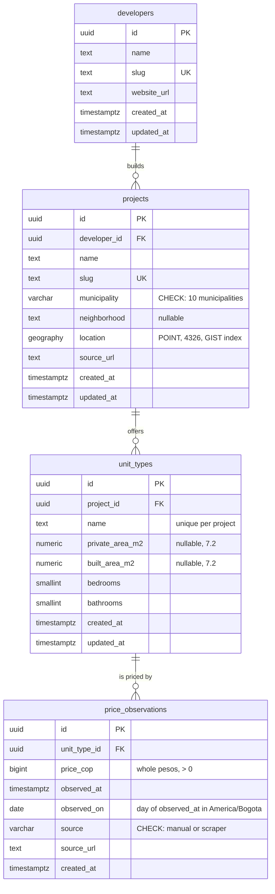

# Database schema v1

Postgres (Supabase, local via `supabase db start`) with PostGIS. Alembic is the only owner of the schema: see `migrations/versions/0001_schema_v1.py`. The models live in `src/sobreplano/infrastructure/db/models.py`.

## Rules the database enforces

- **Price observations are append-only** (constitution, principle 2). A trigger on `price_observations` rejects `UPDATE` and `DELETE` per row, and `TRUNCATE` per statement, with `price_observations is append-only`. The table has no `updated_at`.
- **One observation per unit type per day:** unique (`unit_type_id`, `observed_on`). Because the table is append-only, a duplicate could not be removed later, so the use case checks first and a retry is not an error.
- **A unit type needs at least one area**, and any given area is greater than 0.
- **Row-level security is on** for the four tables and `alembic_version`, with no policies. The Supabase REST API gets no access; the application connects as the table owner and is unaffected.
- **Municipality and source** are `varchar(16)` with a CHECK, not native Postgres enums, which are harder to change in a migration.

## Conventions

- Ids are UUIDs generated in the domain (`uuid4`), so an entity has an identity before it is saved.
- Prices are whole pesos in `bigint`. There are no cents and no float rounding.
- Prices are observed per unit type, not per project, so price per m² can be computed (week 4).
- Coordinates are written as `WKTElement("POINT(lon lat)", srid=4326)` and read with `ST_Y(geometry(location))` and `ST_X(geometry(location))`, without `shapely`.
- Local seed data lives in `seeds/projects.json` (copied by hand from public pages, no scraping). Load it with `uv run --env-file .env python -m sobreplano.interface.cli.seed`; it is idempotent.

## Not in schema v1

`scrape_runs`, users and saved projects, pgvector embeddings, VIS/VIP classification, project stage, zones as polygons and project media (images, video, 3D models). Each arrives in its own spec.
